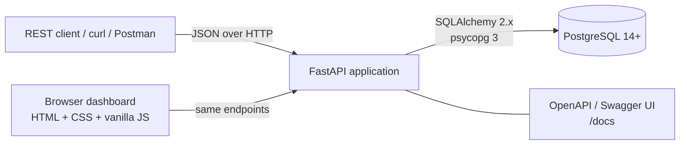
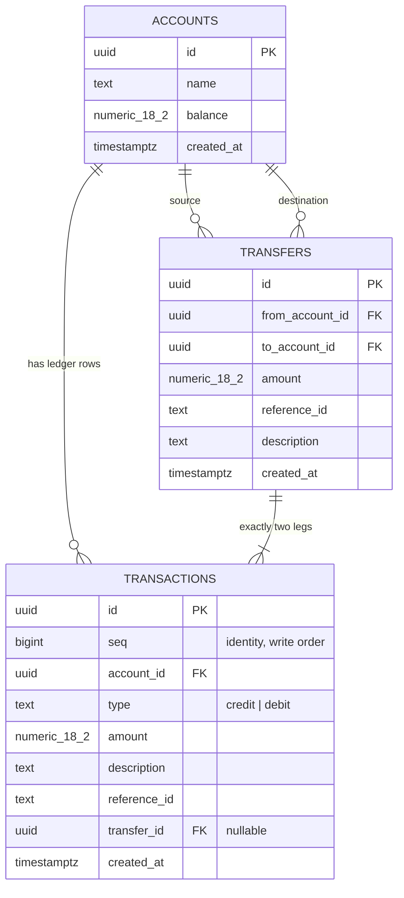
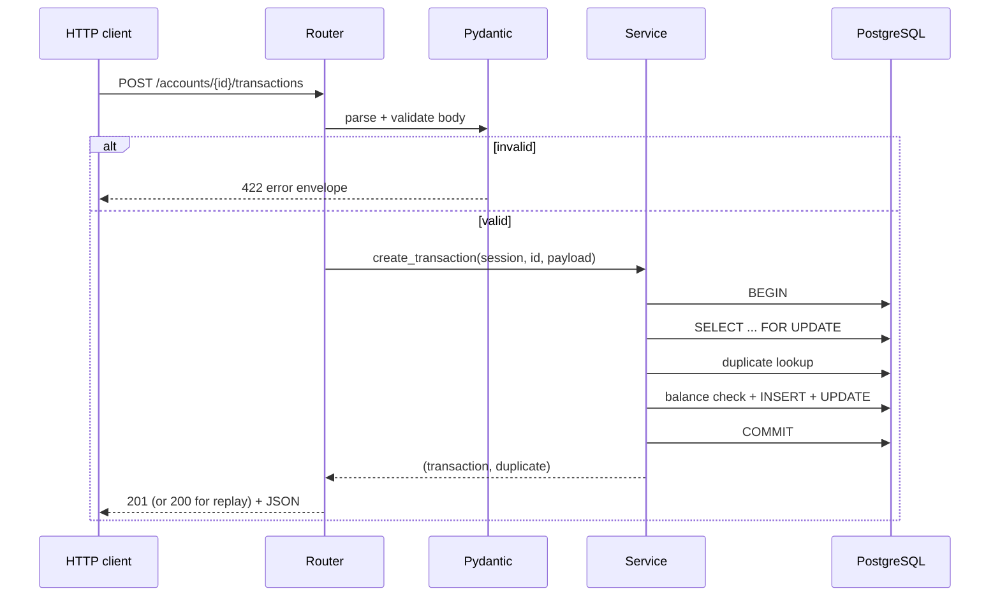
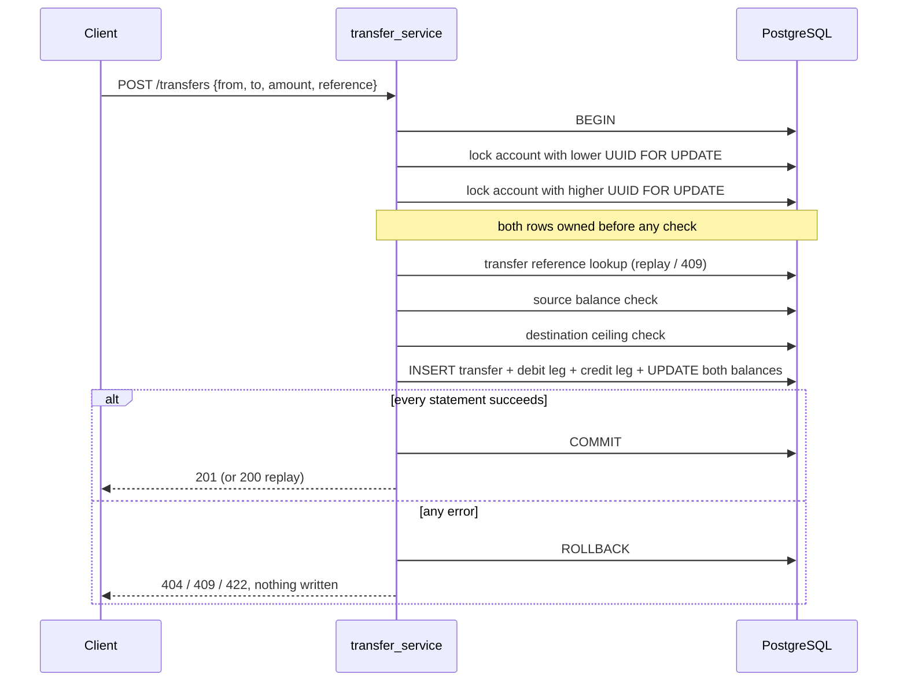
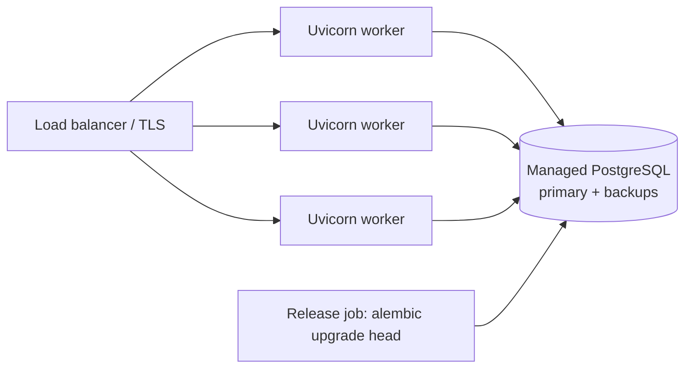

# Architecture

How the Transaction Ledger API is put together, why it is put together that way, and
where each requirement is enforced.

The short version: **FastAPI for HTTP, Pydantic for validation, a small service layer
that owns every database transaction, PostgreSQL as the source of truth, and database
constraints as the last line of defence against bad balances.**

---

## 1. Goals and non-goals

**Goals**

- Correct balances under retries, concurrent requests and failures.
- One predictable error envelope and honest HTTP status codes.
- A schema that cannot hold an invalid state, even if application code is wrong.
- Plain, runnable local setup: Python + PostgreSQL, `alembic upgrade head`, `uvicorn`.
- A UI that needs no build step or second server.

**Non-goals (documented in `ASSUMPTIONS.md`)**

- Authentication / authorization, tenancy, multiple currencies.
- Account deletion or editing. Corrections are new transactions.
- Integer-cent money or a full double-entry journal.

---

## 2. System context



One process serves the API, the OpenAPI docs, the health check and the dashboard.
There is no queue, cache, worker or second service: the database is the only stateful
component, so there is no cache-invalidation or dual-write problem to solve.

---

## 3. Layers

```
┌──────────────────────────────────────────────────────────────┐
│ HTTP layer        app/api/*.py                               │
│   routing, status codes, query params, response models       │
├──────────────────────────────────────────────────────────────┤
│ Contract layer    app/schemas.py                             │
│   Pydantic v2: types, strict money parsing, extra="forbid"   │
├──────────────────────────────────────────────────────────────┤
│ Domain layer      app/services/*.py                          │
│   rules, locking, idempotency, transaction boundary          │
├──────────────────────────────────────────────────────────────┤
│ Persistence       app/models.py + migrations/                │
│   SQLAlchemy mapping; schema/constraints owned by Alembic    │
├──────────────────────────────────────────────────────────────┤
│ Database          PostgreSQL                                 │
│   constraints, unique indexes, row locks, NUMERIC money      │
└──────────────────────────────────────────────────────────────┘
```

| Layer | May do | Must not do |
|---|---|---|
| `app/api` | Parse path/query, call one service function, choose HTTP status | Contain business rules or raw SQL |
| `app/schemas` | Validate and serialise the wire format | Touch the database |
| `app/services` | Own the DB transaction, lock rows, enforce rules | Know about HTTP or response objects |
| `app/models` | Describe tables/columns | Own constraints (the migration does) |
| `migrations` | Create schema, constraints, indexes | Contain business logic |

Dependency direction is strictly downward. Routers import services, services import
models/schemas, nothing imports upwards.

**Rule of the house:** only `ledger_service` and `transfer_service` change balances or
insert ledger rows, and each service call owns **exactly one** database transaction.
Nothing below the service layer commits.

---

## 4. Module map

```
app/
  main.py                     app factory wiring, routers, /health, static dashboard
  api/
    accounts.py               POST /accounts, GET /accounts, GET /accounts/{id},
                              GET /accounts/{id}/balance
    transactions.py           POST/GET /accounts/{id}/transactions
    transfers.py              POST /transfers                    (bonus)
  services/
    account_service.py        create / list / require account
    ledger_service.py         credit, debit, duplicate resolution, history
    transfer_service.py       atomic two-legged transfer, transfer idempotency
    _locking.py               the only place that takes account row locks
    _db_utils.py              extract the violated constraint name
  schemas.py                  request/response models, Money type
  models.py                   Account, Transaction, Transfer
  core/
    config.py                 .env loading, DATABASE_URL, pool sizes
    db.py                     engine + one Session per request
    money.py                  NUMERIC(18,2) balance ceiling
    errors.py                 AppError hierarchy, error envelope, handlers
  static/                     dashboard: index.html, styles.css, app.js
migrations/versions/
  0001_initial.py             tables, CHECKs, UNIQUEs, FKs, indexes
tests/                        API, money, concurrency, lock order, UI
scripts/setup_db.sql          local role + ledger / ledger_test databases
```

---

## 5. Data model



### Why `accounts.balance` exists next to the ledger rows

The balance is a **denormalised running total**, updated in the same transaction as
the ledger row. Reading a balance is O(1) instead of aggregating all history. The
invariant

```
accounts.balance = SUM(credits) - SUM(debits)   for that account
```

is asserted after the concurrency and transfer tests (`assert_reconciled`), so drift
cannot go unnoticed. A production-scale design would use an append-only journal with
periodic snapshots; for this service the running balance plus reconciliation tests is
simpler and verifiably correct.

Transfers create **two ordinary transaction rows** (a debit leg and a credit leg)
sharing a `transfer_id`. That means history needs no special cases: a transfer simply
appears as a debit for the source and a credit for the destination.

### Integrity enforced by PostgreSQL

| Constraint | Prevents |
|---|---|
| `PRIMARY KEY` on all three tables | duplicate ids |
| `CHECK (balance >= 0)` | overdraft from any code path |
| `CHECK (amount > 0)` | zero / negative amounts |
| `CHECK (type IN ('credit','debit'))` | invalid types |
| `CHECK (length(trim(name)) > 0)` | blank account names |
| `CHECK (length(trim(reference_id)) > 0)` | blank references |
| `UNIQUE (account_id, reference_id)` | duplicate transactions per account |
| `UNIQUE (from_account_id, reference_id)` | duplicate transfers per source |
| `CHECK (from_account_id <> to_account_id)` | self-transfers |
| `NOT NULL` on required columns | missing data |
| `FOREIGN KEY` to `accounts` / `transfers` | orphans |
| `UNIQUE (seq)` + identity | ambiguous history order |

The API validates the same rules first to return friendly `422`s, but the database is
what guarantees them. `tests/test_money.py` exercises the constraints with raw SQL so
they are tested independently of the API.

Money is `NUMERIC(18,2)` in PostgreSQL, `Decimal` in Python and a 2-decimal **string**
(`"150.00"`) in JSON. Floats are never used for arithmetic.

---

## 6. Request lifecycle



- `get_db` yields one `Session` per request and closes it in `finally`. Services call
  `db.begin()` themselves, so the transaction boundary is explicit and testable.
- Any exception inside `with db.begin()` rolls the whole unit back, including the
  balance update. A failed debit therefore leaves no trace and does not consume its
  `reference_id`.
- `expire_on_commit=False` keeps committed objects readable while the response model
  is built.
- Response models serialise `Decimal` through `Money`, so JSON contains `"150.00"`,
  never `150.00000000000003`.

---

## 7. Write protocols

### 7.1 Credit

1. `BEGIN`
2. `SELECT ... FOR UPDATE` the account (404 if absent)
3. Look up `(account_id, reference_id)`; replay/409 if present
4. `new_balance = balance + amount`; reject with `409 BALANCE_LIMIT_EXCEEDED` if it
   would exceed `9999999999999999.99`
5. `INSERT` transaction, `UPDATE` balance
6. `COMMIT`

### 7.2 Debit

Same as credit, with step 4 replaced by: reject with `409 INSUFFICIENT_BALANCE` if
`balance < amount`. The check happens **while holding the row lock**, so a concurrent
debit cannot slip between the read and the write.

### 7.3 Duplicate `reference_id`

| Situation | Result |
|---|---|
| First use | `201`, new row, balance changes |
| Same account + reference + same type/amount/description | `200`, original row, `"duplicate": true`, balance unchanged |
| Same account + reference + different payload | `409 REFERENCE_ID_CONFLICT`, balance unchanged |
| Same reference on a different account | allowed, independent transaction |

`reference_id` is trimmed, so `"PAY-1"` and `"PAY-1 "` are the same key. Equality uses
the normalised values (`Decimal` for amount, `None` for blank description), so
`"500.00"` and `500` are the same request.

If the pre-check ever misses, `UNIQUE (account_id, reference_id)` raises
`IntegrityError`; the service names the constraint, rolls back the attempted balance
change, re-reads in a fresh transaction and replays the original. This fallback is
covered by a test that deliberately blinds the pre-check.

### 7.4 Atomic transfer (bonus)



- Both accounts are locked **before** the duplicate lookup, so idempotency and balance
  checks see a stable pair of rows.
- Source and destination must differ (Pydantic `422` and a database `CHECK`).
- Leg references are derived from the transfer UUID (`"<uuid>:out"`, `"<uuid>:in"`),
  never from client input, so they cannot collide with a client's reference.
- `tests/test_transfers.py::test_failure_on_the_second_leg_rolls_everything_back` injects a
  failure between the legs and asserts that balances, ledger rows and the transfer row
  are all unchanged.
- A partial transfer is therefore impossible: there is no intermediate commit.

### 7.5 Why the caller owns `reference_id`

`id` and `reference_id` answer two different questions:

| Field | Generated by | Meaning |
|---|---|---|
| `id` | server | identity of a row that already exists |
| `reference_id` | caller | identity of an intent that may be retried |

The API contract requires that a repeated `reference_id` must not create a second
transaction. That only works if the **same value arrives twice**. A server that
invents a reference on every request can never see the second request as a retry; it
would apply the credit twice and violate the contract.

There is also a semantics problem with deduplicating on the payload instead: two genuinely separate
credits can have the same type, amount and description (two coffees at 3.50). Only the caller can say
"this is the same intent as before" versus "this is a new, identical intent". That is what the key
captures.

**Industry practice is the same.** Stripe's documentation: "A client generates an idempotency key, which
is a unique key that the server uses to recognize subsequent retries of the same request… we suggest using
V4 UUIDs." The IETF `Idempotency-Key` draft defines it as "a unique value generated by the client which the
resource uses to recognize subsequent retries of the same request", with uniqueness "implemented by the
clients". This API uses `reference_id` for the same concept.

**What this means in practice**

- The API requires `reference_id`; omitting it is a `422`, never a silent server-generated value.
- Clients should generate a UUID immediately before the first attempt and keep it for every retry.
- The dashboard does exactly that in `app.js` (`crypto.randomUUID()` with a fallback), prefills the field,
  keeps the value on failure, and rotates it only after the operation completes. The human never has to
  type a reference. The field sits under a collapsed **Advanced details** section, so the everyday form is
  just amount and description, but a business identifier can still be entered.
- Before sending a write, the dashboard stores the payload in `localStorage`. If the response is lost
  (network error or `5xx`), the record survives a refresh: the dashboard restores the fields, the same
  reference and a banner, so submitting again is an idempotent retry rather than a double entry. A
  definitive `4xx` response clears the record because nothing was written.
- A business identifier (invoice number, payment id) is also a valid reference, which is why the field
  stays editable rather than read-only.
- If a retry changes the payload, the server returns `409 REFERENCE_ID_CONFLICT` instead of silently
  applying a different operation under the old key.

**Summary:** the server cannot distinguish a retry from a new transaction unless the caller repeats a key,
and that key is `reference_id`.

---

## 8. Concurrency model

| Concern | Mechanism |
|---|---|
| Lost update on balance | `SELECT ... FOR UPDATE` before read-modify-write |
| Overdraft under parallel debits | balance check executed while holding the lock |
| Duplicate under parallel retries | row lock serialises them; `UNIQUE` is the backstop |
| Deadlock between opposing transfers | lock both accounts one statement at a time, ascending UUID |
| Stale reads | no cache, no replicas; every read goes to the primary |
| Isolation | PostgreSQL default `READ COMMITTED` is sufficient with explicit row locks |

**Why one statement per lock?** `SELECT ... WHERE id IN (...) ORDER BY id FOR UPDATE`
usually locks in sorted order in PostgreSQL, but that is a property of the plan, not a
SQL guarantee. Issuing one `SELECT ... FOR UPDATE` per account in ascending
`UUID.int` order makes the order true by construction. `tests/test_lock_order.py`
observes PostgreSQL directly: it holds the lower-id account and checks with `NOWAIT`
that a waiting transfer owns neither account yet, using the higher-to-lower direction
where from/to order would otherwise show the bug.

A single-account transaction holds one lock and waits for nothing else, so it cannot
participate in a lock cycle with a two-account transfer.

Evidence from the suite: 20 parallel debits of 10 against a balance of 100 → exactly
10 succeed and the balance is 0; 20 identical submissions → one row, one balance
change; 20 opposing A→B / B→A transfers → no deadlock.

---

## 9. Error model

One envelope for every failure, including framework-level ones:

```json
{ "error": { "code": "INSUFFICIENT_BALANCE",
             "message": "Account does not have sufficient balance.",
             "details": { "balance": "100.00", "requested": "150.00" } } }
```

| HTTP | `code` | Cause |
|---|---|---|
| `404` | `ACCOUNT_NOT_FOUND` | well-formed id, no such account |
| `409` | `INSUFFICIENT_BALANCE` | debit/transfer larger than the balance |
| `409` | `BALANCE_LIMIT_EXCEEDED` | result would exceed `NUMERIC(18,2)` |
| `409` | `REFERENCE_ID_CONFLICT` | reference reused with a different payload |
| `422` | `INVALID_TRANSACTION_TYPE` | `type` is not `credit`/`debit` |
| `422` | `INVALID_AMOUNT` | missing, ≤ 0, > 2 dp, too large, non-plain decimal |
| `422` | `INVALID_PAGINATION` | `limit` outside 1–100, `offset` < 0, non-numeric |
| `422` | `VALIDATION_ERROR` | bad JSON, missing/blank fields, unknown fields, malformed UUID |
| `404` | `NOT_FOUND` | unknown route |
| `405` | `METHOD_NOT_ALLOWED` | wrong method |
| `500` | `INTERNAL_ERROR` | unexpected failure, logged, no internals leaked |

Validation failures include `details.errors[]` with `{field, message, type}`, so a
client can highlight the exact field. Status-code choices: `422` for malformed input,
`404` for a missing resource, `409` for a well-formed request that conflicts with
current state (insufficient funds, reference conflict, balance ceiling).

---

## 10. API surface

| Method | Path | Purpose |
|---|---|---|
| `POST` | `/accounts` | create account (`201`) |
| `GET` | `/accounts?limit=&offset=` | list accounts for the dashboard (`200`) |
| `GET` | `/accounts/{id}` | one account (`200`) |
| `GET` | `/accounts/{id}/balance` | `{account_id, balance}` (`200`) |
| `POST` | `/accounts/{id}/transactions` | credit/debit (`201`, `200` on replay) |
| `GET` | `/accounts/{id}/transactions?type=&limit=&offset=` | history (`200`) |
| `POST` | `/transfers` | atomic transfer (`201`, `200` on replay) |
| `GET` | `/health` | database liveness (`200`) |
| `GET` | `/` | dashboard (not part of the API schema) |

History is ordered by `seq DESC`, not `created_at`: `now()` is transaction start time,
so a request that waited on a lock could otherwise appear older than one that committed
first. `seq` follows the order rows were actually written under the account lock.

---

## 11. Persistence and migrations

- `migrations/versions/0001_initial.py` is the **source of truth** for the schema. It
  is handwritten SQL so constraint names, `CHECK`s and partial indexes are explicit.
- `app/models.py` describes columns only; it intentionally does not duplicate indexes
  and constraints.
- Consequence: `alembic check` / autogenerate reports the raw-SQL constraints as drift.
  That is expected; migrations, not autogenerate, are authoritative. The real test is
  `alembic upgrade head` on an empty database plus the constraint tests.
- `scripts/setup_db.sql` creates the `ledger` role and the `ledger` / `ledger_test`
  databases. Tests apply the real migration to `ledger_test` and truncate between
  tests; they refuse to run unless the database name contains `test`.

---

## 12. Runtime and deployment

**Local (documented in README)**

```bash
psql -U postgres -f scripts/setup_db.sql
python -m venv .venv && source .venv/bin/activate
pip install -r requirements.txt
cp .env.example .env
alembic upgrade head
uvicorn app.main:app --reload
pytest
```

`.env` is loaded from the project root regardless of the current working directory, so
`uvicorn` and `alembic` behave the same when started elsewhere.

**Production shape (not implemented, by design)**



- Run `uvicorn`/`gunicorn` with multiple workers; the app is stateless.
- Keep `DB_POOL_SIZE × workers` below PostgreSQL's connection limit; a PgBouncer in
  transaction mode would sit in front at higher scale.
- Serve static files from a CDN or reverse proxy if traffic grows; today FastAPI serves
  them directly.
- Add auth, TLS termination, structured logs, metrics, request ids, `lock_timeout`
  and rate limiting before exposing it publicly.

---

## 13. Testing strategy

| Level | What it proves |
|---|---|
| API tests (`test_accounts`, `test_accounts_list`, `test_transactions`, `test_history`, `test_transfers`) | contract, validation, status codes, idempotency, history |
| Money tests (`test_money`) | strict parsing, exact decimals, size limits, DB constraints via raw SQL |
| Concurrency (`test_concurrency`, `test_transfers`, `test_lock_order`) | no overdraft, one row per retry, no deadlock, rollback, reconciliation |
| Persistence check | `stored balance == credits − debits` after concurrent and transfer scenarios |
| UI (`test_ui`) | dashboard served, assets present, no external dependencies, hidden from schema |
| Browser check (manual, DevTools Protocol) | credit, retry, overdraft, transfer, account creation, filter, health, reference recovery, 390px layout |

Current result: **58 passed** against real PostgreSQL. The suite was also checked for
"teeth" by deliberately removing `FOR UPDATE`, reversing lock order, removing the
balance-limit check and relaxing amount parsing; each change makes specific tests fail.

---

## 14. Requirement traceability

| Requirement | Where it lives | Evidence |
|---|---|---|
| Create account; unique id | `api/accounts.py`, `account_service.create_account`, UUID primary key | `test_create_account_starts_at_zero` |
| Name required, non-blank | `schemas.AccountCreate`, DB `CHECK` | `test_invalid_account_input_is_rejected` |
| Initial balance always 0, not client-settable | service forces `Decimal("0")`; `extra="forbid"` | `test_create_account_starts_at_zero`, `test_invalid_account_input_is_rejected` |
| `created_at` system-generated | DB `DEFAULT clock_timestamp()` | create-account tests |
| Credit increases balance (100 + 50 = 150) | `ledger_service._apply` | `test_credit_then_debit_updates_balance` |
| Debit decreases balance (100 − 30 = 70) | `ledger_service._apply` | `test_credit_then_debit_updates_balance` |
| Debit rejected when insufficient; balance unchanged | lock + check + rollback | `test_insufficient_debit_changes_nothing` |
| Duplicate reference per account: no new row, no balance change, clear response | `_resolve_duplicate`, `UNIQUE (account_id, reference_id)` | `test_identical_retry_is_idempotent` |
| Same reference allowed on another account | composite unique scope | `test_same_reference_on_different_accounts_is_allowed` |
| Balance endpoint with `account_id` + `balance`; 404 if missing | `GET /accounts/{id}/balance`, `require_account` | `test_balance_endpoint_and_missing_account` |
| History for an account | `GET /accounts/{id}/transactions` | `test_history_is_scoped_to_its_account_and_starts_empty` |
| Filter by `credit` / `debit`; both when omitted | `type` query, enum validation | `test_history_is_newest_first_and_filters_by_type`, `test_history_rejects_invalid_parameters` |
| Account id must exist for a transaction | `lock_accounts` raises `AccountNotFound` | `test_transaction_for_missing_account_is_404` |
| Type must be credit/debit | Pydantic enum | `test_invalid_type_and_bad_reference_are_rejected` |
| Amount > 0 | `Field(gt=0)` + DB `CHECK` | `test_invalid_amounts_are_rejected` |
| `reference_id` required | `ReferenceId` (1–128, trimmed) | `test_invalid_type_and_bad_reference_are_rejected` |
| Invalid request body / fields | Pydantic + envelope handlers | `test_framework_errors_use_the_documented_envelope`, `test_invalid_type_and_bad_reference_are_rejected` |
| Invalid pagination | `Query(ge/le)` mapped to `INVALID_PAGINATION` | `test_history_rejects_invalid_parameters`, `test_list_accounts_rejects_invalid_pagination` |
| Consistent errors | single `AppError` envelope | error tests across the suite |
| Bonus: transfer, sufficient balance, both accounts exist | `transfer_service._apply` | `test_successful_transfer_moves_money_and_records_both_legs`, `test_insufficient_transfer_changes_nothing`, `test_transfer_with_a_missing_account_is_404` |
| Bonus: atomic, all-or-nothing | one `db.begin()` around both legs | `test_failure_on_the_second_leg_rolls_everything_back` |
| DB constraints | `0001_initial.py` | `test_database_constraints_protect_invariants` |
| Runnable via README | setup script, `.env.example`, Alembic, README | manual run + README steps |
| Docs / assumptions | `docs/API.md`, `docs/openapi.json`, `ASSUMPTIONS.md` | OpenAPI matches the live app |

---

## 15. Trade-offs and what I would change at scale

| Current choice | Why | At scale |
|---|---|---|
| Running balance column | O(1) reads, simple rules | Append-only journal + snapshots / event sourcing |
| Row locks per account | Simple, exact, no retries | Partition by account, or optimistic concurrency for read-heavy paths |
| Offset pagination | Easy for clients and the dashboard | `seq` cursor pagination for stable pages |
| `reference_id` as idempotency key | Matches the required API contract | Also accept an `Idempotency-Key` header with a stored response |
| Two ledger legs per transfer | History is uniform | Formal double-entry with a journal + postings |
| Money as JSON strings | Exact, explicit | Same, plus a documented minor-unit integer option |
| No auth | Out of scope | OAuth2/JWT, per-account ownership checks |
| One process serves UI + API | Zero build, offline demo | CDN for static assets, separate deploy if needed |
| No `lock_timeout` | Not required for local | `SET LOCAL lock_timeout` + bounded retries |

Known limitations are listed in the README: offset pagination can shift, `total` and
`items` are two queries, single currency, no auth, no deletion.

---

## 16. Summary

The design deliberately puts correctness in two places only: **the service layer's
single transaction with explicit row locks**, and **PostgreSQL constraints**. Everything
else — routers, schemas, models, dashboard — is thin and replaceable. That makes the
system easy to audit: if a balance changed, there is exactly one code path and one
committed transaction that did it, and the ledger reconciles to the stored balance.
